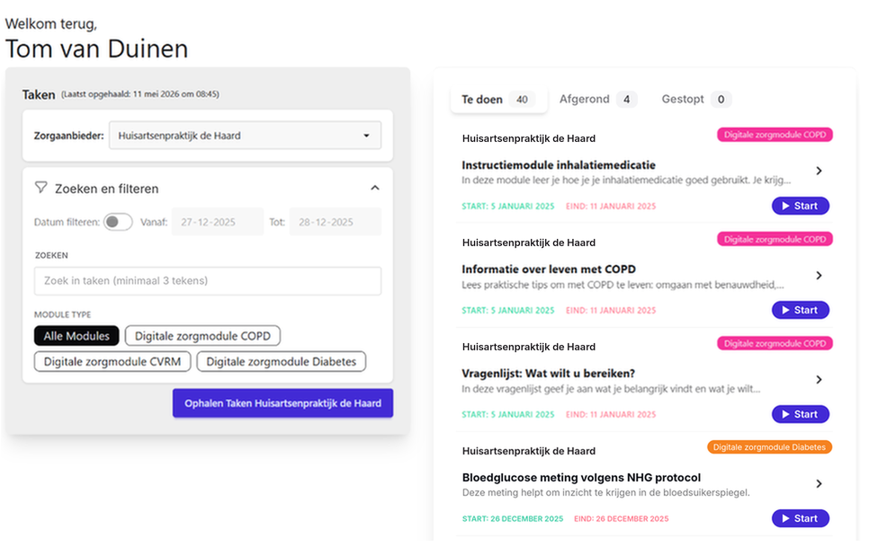
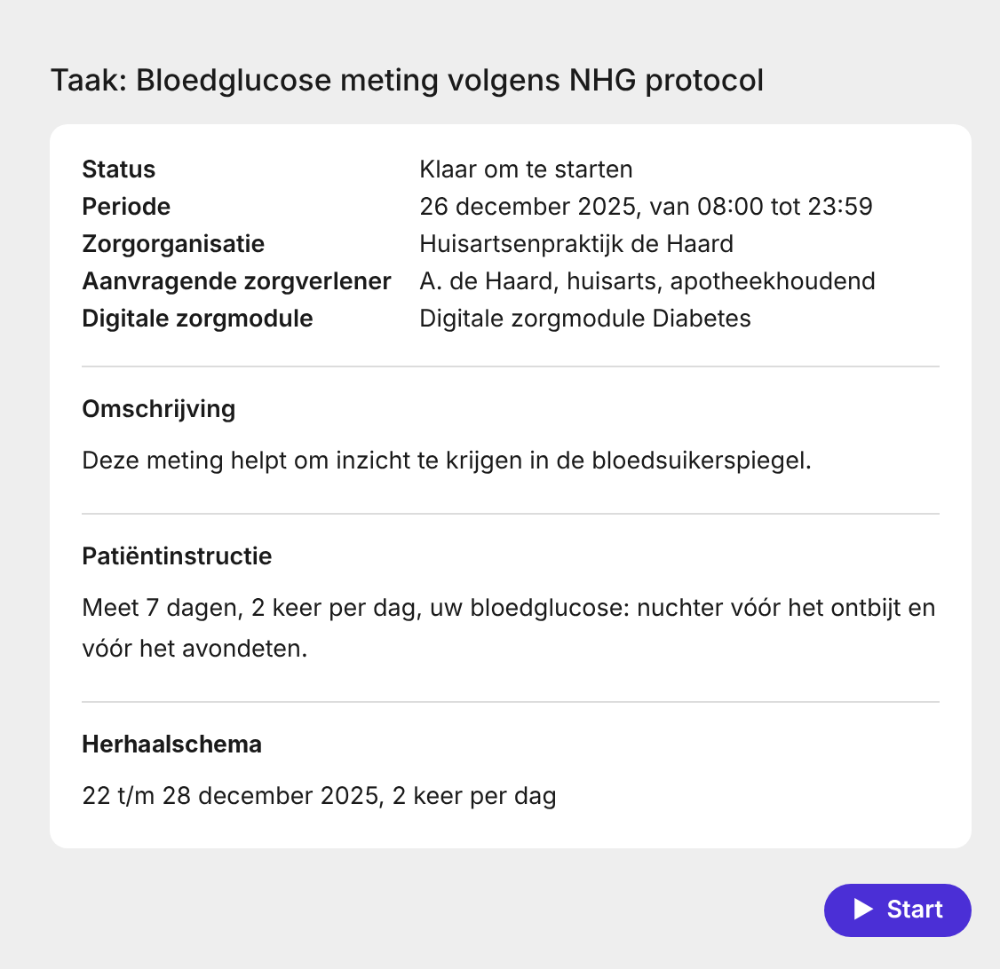

# Weergaverichtlijn Aanbiedertaken

## 1.2.1 Inleiding

Dit is de weergaverichtlijn voor de gegevensdienst Aanbiedertaken.

De richtlijn bevat verplichte acceptatiecriteria. De mockups zijn bedoeld ter inspiratie. Een persoonlijke gezondheidsomgeving (PGO) mag de schermen naar eigen inzicht vormgeven, zolang ze gebruiksvriendelijk zijn en aan de acceptatiecriteria voldoen.

In de gegevensdienst Aanbiedertaken is de PGO-gebruiker altijd de uitvoerder van een taak. Alleen de uitvoerder kan een taak op pauze zetten. De indeling van statussen in taakstatusgroepen gaat van dit uitgangspunt uit.

## 1.2.2 Doel

Deze richtlijn helpt ontwikkelaars van PGO's om aanbiedertaken begrijpelijk weer te geven. Dat doet de richtlijn door:

- per dataveld een begrijpelijke term en, waar nodig, een toelichting te geven;

- te beschrijven welke gegevens het takenoverzicht en de taakdetails tonen, en in welke volgorde;

- te beschrijven hoe de PGO de gebruiker informeert, bijvoorbeeld als het verzamelen van taken niet lukt of als gegevens mogelijk niet actueel zijn.

De richtlijn beschrijft wélke gegevens de PGO toont en hoe ze heten. Daarnaast beschrijft de richtlijn gebruikersdoelen: wat de gebruiker moet kunnen zien, weten of doen. Een gebruikersdoel zegt wat er moet gebeuren, niet hoe. Hoe de PGO een gebruikersdoel uitwerkt en hoe de schermen eruitzien (kleur, vorm, lettertype), bepaalt de PGO-leverancier zelf.

Zorgverleners kunnen de richtlijn gebruiken bij het schrijven van titels, omschrijvingen en patiëntinstructies, zodat die begrijpelijk zijn voor de PGO-gebruiker.

## 1.2.3 Scope

De richtlijn gaat over de gegevens van aanbiedertaken die de PGO toont. Gegevens die de PGO via andere MedMij-gegevensdiensten verzamelt, vallen erbuiten.

De richtlijn gaat over taken die de PGO-gebruiker zelf uitvoert. Het profiel staat ook andere uitvoerders toe, zoals een zorgverlener, contactpersoon of zorgteam (open-world modelling). Hoe de PGO zulke taken toont, valt buiten deze richtlijn.

Ook buiten de scope vallen:

- inloggen en authenticeren bij de zorgaanbieder;

- het synchroniseren of incrementeel ophalen van taken;

- het technisch starten (launchen) van een aanbiedermodule;

- in deze fase: de reden waarom een taak is gestopt (Task.statusReason).

Zie voor deze onderwerpen het Solution Design en de FHIR Implementation Guide.

## 1.2.4 Inhoud richtlijn

De PGO-gebruiker opent in de PGO het takenoverzicht. Vanuit dat overzicht opent de gebruiker een taak om de details te bekijken. De richtlijn beschrijft daarom twee niveaus van informatie:

1.  het takenoverzicht: de lijst met taken van alle zorgaanbieders en wat de gebruiker per taak direct ziet;

2.  de taakdetails: wat de gebruiker ziet na het openen of uitklappen van één taak.

Op welke manier de PGO de taakdetails toont, bijvoorbeeld door uitklappen, in een paneel of op een apart scherm, bepaalt de PGO zelf. Per onderdeel volgen de acceptatiecriteria en een mockup. De termen per dataveld staan in de Tabel met specificaties (1.2.5), gebaseerd op het Logical Model.

**Waarom takenoverzicht en taakdetails?** PGO's tonen informatie op verschillende manieren: op een apart scherm, door uitklappen of in een paneel naast de lijst, en vaak per apparaat anders. De richtlijn legt daarom niet vast hoeveel schermen er zijn, maar welke informatie de gebruiker direct ziet en welke na een handeling. Zo past de richtlijn bij elk ontwerp, en blijft de PGO vrij in de uitwerking.

### 1.2.4.1 Algemene acceptatiecriteria

Deze criteria gelden voor het takenoverzicht, de taakdetails en het gedrag van de PGO, zoals meldingen bij het verzamelen van taken en het attenderen op de actualiteit van gegevens.

| Nr  | Acceptatiecriterium                                                                                                                                                                                                                                                                                                                                |
|-----|----------------------------------------------------------------------------------------------------------------------------------------------------------------------------------------------------------------------------------------------------------------------------------------------------------------------------------------------------|
| A1  | De PGO gebruikt per dataveld de term uit de kolom Weergavetekst in de PGO van de Tabel met specificaties.                                                                                                                                                                                                                                          |
| A2  | De PGO toont minimaal de datavelden met prioriteit M. De PGO mag aanvullende velden tonen, in het takenoverzicht of alleen in de taakdetails.                                                                                                                                                                                                      |
| A3  | De PGO hoeft lege datavelden niet te tonen.                                                                                                                                                                                                                                                                                                        |
| A4  | De PGO toont de status van een taak met de gebruiksvriendelijke term uit de tabel Taakstatussen en taakstatusgroepen (1.2.4.2).                                                                                                                                                                                                                    |
| A5  | De PGO deelt elke taak in een taakstatusgroep in op basis van de FHIR-status, volgens de tabel Taakstatussen en taakstatusgroepen (1.2.4.2). Op welke manier de PGO de taakstatusgroepen weergeeft, bijvoorbeeld met tabbladen of met filters, bepaalt de PGO zelf.                                                                                |
| A6  | De PGO wijst de gebruiker erop dat de taakgegevens mogelijk niet actueel zijn, met een of meer maatregelen uit de paragraaf Gegevensactualiteit (1.2.4.1.1).                                                                                                                                                                                       |
| A7  | Levert het verzamelen van taken bij een zorgaanbieder een HTTP-statuscode buiten de 2xx-reeks, dan toont de PGO een melding dat het verzamelen bij die zorgaanbieder niet is gelukt.                                                                                                                                                               |
| A8  | Levert het verzamelen van taken bij een zorgaanbieder een HTTP-statuscode in de 2xx-reeks met een lege bundle, dan toont de PGO een melding dat er bij die zorgaanbieder geen nieuwe of gewijzigde taken zijn. Bijvoorbeeld: "Er zijn geen nieuwe of gewijzigde taken bij Huisartsenpraktijk De Haard." Eerder verzamelde taken blijven zichtbaar. |
| A9  | De PGO kiest zelf de tekst van de meldingen in O2, A7 en A8, in woorden van gelijke strekking.                                                                                                                                                                                                                                                     |
| A10 | De gebruiker kan een taak in Te doen of Afgerond starten in de aanbiedermodule, vanuit het takenoverzicht en vanuit de taakdetails. Zie Taak starten (1.2.4.1.2).                                                                                                                                                                                  |

Voor een aantal termen worden nog patiëntvriendelijke termen vastgesteld. Zodra die beschikbaar zijn, vervangen ze de huidige termen in de Tabel met specificaties. (Dit was detailcriterium 1 in alpha.2.)

#### 1.2.4.1.1 Gegevensactualiteit

De PGO wijst de gebruiker erop dat de getoonde taakgegevens mogelijk niet actueel zijn. Daarvoor past de PGO een of meer van deze maatregelen toe:

- De PGO toont per taak de datum en tijd waarop de gegevens voor het laatst zijn opgehaald, in elk geval in de taakdetails.

- De PGO toont een waarschuwing als de taakgegevens ouder zijn dan 24 uur, bij voorkeur in het takenoverzicht met een icoon.

- De PGO vraagt de gebruiker bij het openen van het takenoverzicht om alle taken te verversen.

- De PGO ververst de taken automatisch elke dag. Daarvoor is langdurige toestemming nodig.

- De PGO wijst de gebruiker met herinneringen of waarschuwingen erop dat het verstandig kan zijn om langdurige toestemming te geven.

#### 1.2.4.1.2 Taak starten

De gebruiker voert een taak uit in de aanbiedermodule van de zorgaanbieder. De PGO biedt daarom bij elke taak in Te doen en Afgerond een actie om de taak te starten. Hoe minder handelingen de gebruiker daarvoor nodig heeft, hoe beter.

- **Te doen:** de gebruiker start de taak om hem uit te voeren.

- **Afgerond:** de gebruiker start de taak opnieuw om de resultaten in te zien.

- **Gestopt:** de gebruiker kan de taak niet starten. In de taakdetails ziet de gebruiker de gegevens van de taak, waaronder de status.

Voor de actie wordt een start-icoon aanbevolen. Of er een verklarende tekst bij staat, zoals "Bekijk resultaat" bij Afgerond, bepaalt de PGO zelf. De technische specificaties voor starten van de aanbiedermodule staat in het Solution Design.

### 1.2.4.2 Taakstatussen en taakstatusgroepen

De tabel geeft per FHIR-status de gebruiksvriendelijke term (A4) en de taakstatusgroep (A5).

| FHIR-status      | Gebruiksvriendelijke term | Taakstatusgroep | Opmerkingen                                                                                                                                                                                                                                                |
|------------------|---------------------------|-----------------|------------------------------------------------------------------------------------------------------------------------------------------------------------------------------------------------------------------------------------------------------------|
| requested        | Aangevraagd               | Te doen         |                                                                                                                                                                                                                                                            |
| received         | Ontvangen                 | Te doen         |                                                                                                                                                                                                                                                            |
| accepted         | Geaccepteerd              | Te doen         |                                                                                                                                                                                                                                                            |
| ready            | Klaar om te starten       | Te doen         |                                                                                                                                                                                                                                                            |
| in-progress      | Bezig                     | Te doen         |                                                                                                                                                                                                                                                            |
| on-hold          | Gepauzeerd                | Te doen         |                                                                                                                                                                                                                                                            |
| completed        | Voltooid                  | Afgerond        |                                                                                                                                                                                                                                                            |
| cancelled        | Geannuleerd               | Gestopt         |                                                                                                                                                                                                                                                            |
| rejected         | Afgewezen                 | Gestopt         |                                                                                                                                                                                                                                                            |
| failed           | Mislukt                   | Gestopt         |                                                                                                                                                                                                                                                            |
| draft            | Concept                   |                 | De PGO toont deze status niet                                                                                                                                                                                                                              |
| entered-in-error | Per ongeluk ingevoerd     |                 | De PGO toont deze status niet, (ook niet als de gebruiker de taak eerder heeft gezien. Een taak kan vanuit elke status deze status krijgen. De zorgaanbieder levert de taak dan met deze status aan de PGO, zodat de PGO de taak uit het overzicht haalt.) |

- **Te doen:** openstaande taken die de PGO-gebruiker kan uitvoeren.

- **Afgerond:** taken die zijn afgerond.

- **Gestopt:** taken die niet meer uitgevoerd worden, omdat ze zijn geannuleerd, afgewezen of mislukt.

### 1.2.4.3 Takenoverzicht

Het takenoverzicht toont de taken van alle zorgaanbieders op één pagina, ingedeeld in taakstatusgroepen (A5).

*Figuur 1: Voorbeeld* *takenoverzicht*

| Nr  | Acceptatiecriterium                                                                                                                                                                                                                                                                                                                                                                                                                                                                                                                                                                                                                                                                                                                                                  | Prioriteit |
|-----|----------------------------------------------------------------------------------------------------------------------------------------------------------------------------------------------------------------------------------------------------------------------------------------------------------------------------------------------------------------------------------------------------------------------------------------------------------------------------------------------------------------------------------------------------------------------------------------------------------------------------------------------------------------------------------------------------------------------------------------------------------------------|------------|
| O1  | Het takenoverzicht toont de taken van alle zorgaanbieders waarvan de PGO taakgegevens heeft verzameld.                                                                                                                                                                                                                                                                                                                                                                                                                                                                                                                                                                                                                                                               | M          |
| O2  | Staan er geen taken in een taakstatusgroep, dan toont de PGO een melding, bijvoorbeeld "Je hebt geen taken in deze groep".                                                                                                                                                                                                                                                                                                                                                                                                                                                                                                                                                                                                                                           | M          |
| O3  | In de taakstatusgroep Te doen staat de taak met de vroegste einddatum van de uitvoerperiode standaard bovenaan. Bij een gelijke einddatum beslist de begindatum. Een taak zonder einddatum staat onderaan (zie O9). In Afgerond en Gestopt sorteert de PGO standaard op LastModified, de meest recente eerst. Ontbreekt LastModified, dan sorteert de PGO op de einddatum van de uitvoerperiode.                                                                                                                                                                                                                                                                                                                                                                     | M          |
| O4  | De gebruiker kan zoeken op (een deel van) de tekst in alle datavelden die het takenoverzicht toont. Zoeken in andere datavelden mag, maar is niet verplicht. De PGO bepaalt het minimale aantal tekens; advies: drie.                                                                                                                                                                                                                                                                                                                                                                                                                                                                                                                                                | M          |
| O5  | De gebruiker kan filteren op een of meer waarden van elk dataveld in het takenoverzicht, behalve op velden met vrije tekst: Titel (ActivityDefinition.title) en Omschrijving (Task.description). Filteren op vrije tekst levert te lange lijsten op; voor deze velden gebruikt de gebruiker de zoekfunctie (O4). Minimaal kan de gebruiker filteren op periode, zorgaanbieder en digitaal groepsplan. Het digitale groepsplan is wel vrije tekst (ServiceRequest.code.text), maar een zorgaanbieder gebruikt er maar een beperkt aantal waarden voor. Daarop mag de gebruiker daarom wel filteren. Bij periode kiest de gebruiker zelf de begin- en einddatum. Filteren op de FHIR-status is niet nodig: de taakstatusgroepen (A5) zijn voor de gebruiker voldoende. | M          |
| O6  | De gebruiker kan sorteren op elk dataveld, behalve Omschrijving.                                                                                                                                                                                                                                                                                                                                                                                                                                                                                                                                                                                                                                                                                                     | M          |
| O7  | De PGO toont elke taak één keer. Een taak is uniek op basis van de business identifier. Elke zorgaanbieder bepaalt zelf het system en de waarde daarvan.                                                                                                                                                                                                                                                                                                                                                                                                                                                                                                                                                                                                             | M          |
| O8  | De PGO maakt zichtbaar welke taken de gebruiker al heeft opgepakt: taken met de status in-progress of on-hold. Dat kan bijvoorbeeld met een icoon.                                                                                                                                                                                                                                                                                                                                                                                                                                                                                                                                                                                                                   | S          |
| O9  | Heeft een taak geen einddatum, dan toont de PGO geen einddatum. Bij sorteren en filteren behandelt de PGO de taak als een taak met een einddatum ver in de toekomst.                                                                                                                                                                                                                                                                                                                                                                                                                                                                                                                                                                                                 | M          |

Zoeken is vooral nuttig in de taakstatusgroepen Afgerond en Gestopt, waar taken zich opstapelen.

#### 1.2.4.3.1 Openen van het takenoverzicht

Opent de PGO-gebruiker het takenoverzicht voor het eerst nadat hij de PGO heeft geopend, dan ziet hij direct welke taken zo snel mogelijk een actie van hem vragen: de taken waarvan de uitvoerperiode vandaag of morgen afloopt. Een taak zonder einddatum is dus nooit prominent (zie O9). Een taak is prominent als hij goed zichtbaar is en zich visueel onderscheidt van de andere taken in Te doen.

| Nr  | Acceptatiecriterium                                                                                                                                                                                                                                               | Prioriteit |
|-----|-------------------------------------------------------------------------------------------------------------------------------------------------------------------------------------------------------------------------------------------------------------------|------------|
| O10 | Opent de gebruiker het takenoverzicht voor het eerst nadat hij de PGO heeft geopend, dan staan de taken in de taakstatusgroep Te doen waarvan de uitvoerperiode vandaag of morgen afloopt, prominent bovenaan. Dit geldt elke keer dat de gebruiker de PGO opent. | M          |
| O11 | Passen niet al deze taken tegelijk op het scherm, dan is in elk geval de taak zichtbaar met de vroegste einddatum (zie O3).                                                                                                                                       | M          |

Keert de gebruiker na het uitvoeren van een taak in de aanbiedermodule terug in de PGO, dan bepaalt de PGO zelf welke taken prominent staan. Ook of een taak waarvan de uitvoerperiode al is verlopen prominent staat, bepaalt de PGO zelf.

### 1.2.4.4 Taakdetails

De gebruiker ziet de taakdetails na het openen of uitklappen van een taak in het takenoverzicht. De gegevens in de mockup zijn fictief.

*Figuur 2:* *Voorbeeld taakdetails*

| Nr  | Acceptatiecriterium                                                                                                                                                                                | Prioriteit |
|-----|----------------------------------------------------------------------------------------------------------------------------------------------------------------------------------------------------|------------|
| D1  | De taakdetails tonen de datavelden met code a en b uit de Tabel met specificaties, volgens hun prioriteit: velden met prioriteit M altijd, met S bij voorkeur, en met C als de PGO daarvoor kiest. | M          |
| D2  | Bevat de taak een patiëntinstructie, dan toont de PGO die in de taakdetails.                                                                                                                       | M          |

De patiëntinstructie is een instructie voor deze ene gebruiker. De zorgverlener kan die invoeren bij het klaarzetten van de digitale activiteit. Algemene instructies staan in de aanbiedermodule zelf en vallen buiten deze richtlijn.

### 1.2.4.5 Voorbeeld

Het voorbeeld toont twee taken van dezelfde zorgaanbieder in het takenoverzicht en in de taakdetails. Velden zonder waarde zijn weggelaten (criterium A3).

**Takenoverzicht**

| Titel                                    | Omschrijving                                                      | Periode                   | Zorgorganisatie             | Digitale zorgmodule          |
|------------------------------------------|-------------------------------------------------------------------|---------------------------|-----------------------------|------------------------------|
| Gezonder gaan leven                      |                                                                   | 22-12-2025 t/m 28-12-2025 | Huisartsenpraktijk De Haard |                              |
| Bloedglucose meting volgens NHG protocol | Deze meting helpt om inzicht te krijgen in de bloedsuikerspiegel. | 26-12-2025                | Huisartsenpraktijk de Haard | Digitale zorgmodule Diabetes |

**Taakdetails: Gezonder gaan leven**

| Veld                     | Waarde                      |
|--------------------------|-----------------------------|
| Titel                    | Gezonder gaan leven         |
| Status                   | Aangevraagd                 |
| Periode                  | 22-12-2025 t/m 28-12-2025   |
| Aanvragende zorgverlener | A. de Haard, huisarts       |
| Zorgorganisatie          | Huisartsenpraktijk De Haard |

**Taakdetails:** **Bloedglucose meting volgens NHG protocol**

| Veld                     | Waarde                                                                                         |
|--------------------------|------------------------------------------------------------------------------------------------|
| Titel                    | Bloedglucose meting volgens NHG protocol                                                       |
| Omschrijving             | Deze meting helpt om inzicht te krijgen in de bloedsuikerspiegel.                              |
| Status                   | Klaar om te starten                                                                            |
| Periode                  | 26-12-2025, van 08:00 tot 23:59                                                                |
| Aanvragende zorgverlener | A. de Haard, huisarts, apotheekhoudend                                                         |
| Zorgorganisatie          | Huisartsenpraktijk de Haard                                                                    |
| Digitale zorgmodule      | Digitale zorgmodule Diabetes                                                                   |
| Patiëntinstructie        | Meet 7 dagen, 2 keer per dag, uw bloedglucose: nuchter vóór het ontbijt en vóór het avondeten. |
| Herhaalschema            | 22-12-2025 t/m 28-12-2025, 2 keer per dag                                                      |

## 1.2.5 Tabel met specificaties

De tabellen tonen per dataveld van de gegevensdienst Aanbiedertaken waar de PGO het toont, met welke term en met welke prioriteit. De prioriteit volgt de MoSCoW-methode. Een dataveld dat niet in de tabellen staat, heeft prioriteit W.

| Prioriteit    | Omschrijving                                                                                                                                                                                                                                                                                                                                                                                                                                                                         |
|---------------|--------------------------------------------------------------------------------------------------------------------------------------------------------------------------------------------------------------------------------------------------------------------------------------------------------------------------------------------------------------------------------------------------------------------------------------------------------------------------------------|
| M(ust have)   | Nodig voor de basisfunctionaliteit van de toepassing en moet worden geïmplementeerd om het proces succesvol te laten verlopen.                                                                                                                                                                                                                                                                                                                                                       |
| S(hould have) | Belangrijke functionaliteit die niet vereist is, maar die voordelen biedt voor gebruikers en de algehele gebruikservaring.                                                                                                                                                                                                                                                                                                                                                           |
| C(ould have)  | Gewenste functionaliteit die waarde toevoegt, maar minder kritisch is en indien nodig kan worden uitgesteld.                                                                                                                                                                                                                                                                                                                                                                         |
| W(on't have)  | Functionaliteiten die nu buiten scope zijn maar mogelijk in de toekomst worden overwogen. PGO's hebben de vrijheid om deze datavelden desondanks toch te tonen. Het uitgangspunt is echter dat deze velden niet primair worden weergegeven, zodat de gebruiker deze informatie niet direct ziet. De gegevens zijn alleen beschikbaar wanneer de gebruiker hier expliciet naar zoekt of doorklikt, aangezien deze datavelden geen duidelijke meerwaarde hebben voor directe weergave. |

De kolom Waar tonen geeft aan waar de gebruiker het veld ziet.

| Code | Betekenis                                                    |
|------|--------------------------------------------------------------|
| a    | Direct zichtbaar in het takenoverzicht, en in de taakdetails |
| b    | Alleen in de taakdetails                                     |
| c    | Niet tonen                                                   |

De gegevensdienst bestaat uit vier samenhangende Logical Models:

- **Taak (Task):** de taak zelf, met status, periode, aanvrager en zorgorganisatie.

- **Digitale activiteit (ActivityDefinition):** de herbruikbare beschrijving van de activiteit waar de taak naar verwijst. Levert de titel die het takenoverzicht toont.

- **Uitvoeringsopdracht (ServiceRequest):** alleen aanwezig als de taak een patiëntinstructie of herhaalschema heeft (via Task.focus).

- **Digitaal groepsplan (DigitalGroupPlan):** bundelt verwante taken binnen dezelfde digitale zorgmodule en levert het label waarmee de groep wordt getoond.

### 1.2.5.1 Taak (Task)

Zie Logical Model Task.

| Naam data-item                           | Type        | Id                | Voorbeeld                                                                      | Waar tonen | Opmerkingen                                                                                                                                                                                                  | Weergavetekst in de PGO  | Toelichting voor de gebruiker                                                           | Prioriteit |
|------------------------------------------|-------------|-------------------|--------------------------------------------------------------------------------|------------|--------------------------------------------------------------------------------------------------------------------------------------------------------------------------------------------------------------|--------------------------|-----------------------------------------------------------------------------------------|------------|
| Taak                                     | Rootconcept | pt-dataelement-1  |                                                                                |            |                                                                                                                                                                                                              | Taak                     |                                                                                         |            |
| DigitalActivity                          | Reference   | pt-dataelement-2  | Bloedglucose meting volgens NHG protocol                                       | a          | Verwijzing naar de digitale activiteit. Toon de titel uit Title (pt-dataelement-10).                                                                                                                         | Titel                    |                                                                                         | M          |
| GroupPlan::DigitalGroupPlan              | Reference   | pt-dataelement-3  | Digitale zorgmodule Diabetes                                                   | a          | Toon de display-waarde van Task.basedOn. Die bevat de waarde van code.text uit het ServiceRequest waarnaar de taak verwijst. Zie 1.2.5.4.                                                                    | Digitale zorgmodule      |                                                                                         | M          |
| Status                                   | Item        | pt-dataelement-4  | received                                                                       | b          | In het takenoverzicht toont de PGO de status niet als tekst. Wel kan de PGO zichtbaar maken dat de gebruiker een taak al heeft opgepakt (O8).                                                                | Status                   | Gebruiksvriendelijke term volgens de tabel Taakstatussen en taakstatusgroepen (1.2.4.2) | M          |
| Priority                                 | Item        | pt-dataelement-5  | routine                                                                        | c          |                                                                                                                                                                                                              |                          |                                                                                         | W          |
| Description                              | Item        | pt-dataelement-6  | Deze meting helpt om inzicht te krijgen in de bloedsuikerspiegel.              | a          |                                                                                                                                                                                                              | Omschrijving             |                                                                                         | M          |
| ExecutionPeriod                          | Item        | pt-dataelement-7  | 2025-12-26T07:00:00+00:00 t/m 2025-12-26T22:59:00+00:00                        | a          | Periode waarin de gebruiker de taak moet of mag uitvoeren (begin en einde). De einddatum kan leeg zijn; zie O9.                                                                                              | Periode                  |                                                                                         | M          |
| AuthoredOn                               | Item        | pt-dataelement-34 | 2025-12-19T10:20:00+00:00                                                      | b          | Datum en tijd waarop de taak is aangemaakt. Toont de PGO het, dan alleen in de taakdetails.                                                                                                                  | Aangemaakt op            |                                                                                         | C          |
| LastModified                             | Item        | pt-dataelement-35 | 2025-12-22T06:03:00+00:00                                                      | b          | Datum en tijd van de laatste wijziging van de taak. Sorteerdatum voor Afgerond en Gestopt (O3). Toont de PGO het, dan alleen in de taakdetails.                                                              | Laatst gewijzigd         |                                                                                         | C          |
| Identifier                               | Identifier  | pt-dataelement-33 | TASK-Glucose-9                                                                 | b          | Kenmerk van de taak bij de zorgaanbieder. De PGO gebruikt de business identifier om taken te ontdubbelen (O7). Toont de PGO het, dan alleen in de taakdetails.                                               | Taaknummer               |                                                                                         | C          |
| Requester::PractitionerRole.Practitioner | Reference   | pt-dataelement-8  | A. de Haard, Huisarts, apotheekhoudend                                         | b          | De zorgverlener waarnaar de PractitionerRole (pt-dataelement-8) verwijst. Toon de naam en het specialisme.                                                                                                   | Aanvragende zorgverlener |                                                                                         | S          |
| Requester::PractitionerRole.Organization | Reference   | pt-dataelement-8  | Huisartsenpraktijk de Haard                                                    | a          | De organisatie waarnaar de PractitionerRole (pt-dataelement-8) verwijst. Voluit, bij voorkeur zonder afkortingen.                                                                                            | Zorgorganisatie          |                                                                                         | M          |
| ExecutionOrder                           | Reference   | pt-dataelement-19 | ServiceRequest/ProviderTasks-ServiceRequest-Execution-Glucosemeting-Van-Duinen | b          | Verwijzing naar de uitvoeringsopdracht (1.2.5.3).                                                                                                                                                            |                          |                                                                                         | C          |
| Owner                                    | Reference   | pt-dataelement-24 | Tom van Duinen                                                                 | c          | Voorlopige weergave. De partij die de taak uitvoert. In deze richtlijn is dat de PGO-gebruiker. Het profiel staat ook andere uitvoerders toe (open-world modelling); die vallen buiten de scope (zie 1.2.3). |                          |                                                                                         | W          |

### 1.2.5.2 Digitale activiteit (ActivityDefinition)

Zie Logical Model Digital activity.

| Naam data-item      | Type        | Id                | Voorbeeld                                | Waar tonen | Opmerkingen                                                      | Weergavetekst in de PGO | Toelichting voor de gebruiker | Prioriteit |
|---------------------|-------------|-------------------|------------------------------------------|------------|------------------------------------------------------------------|-------------------------|-------------------------------|------------|
| Digitale activiteit | Rootconcept | pt-dataelement-9  |                                          |            | Herbruikbare beschrijving van een digitale (eHealth-)activiteit. | Digitale activiteit     |                               |            |
| Title               | Item        | pt-dataelement-10 | Bloedglucose meting volgens NHG protocol | a          | De titel die het takenoverzicht toont.                           | Titel                   |                               | M          |

### 1.2.5.3 Uitvoeringsopdracht (ServiceRequest)

Zie Logical Model Execution order. Deze gegevens zijn alleen aanwezig als de taak een patiëntinstructie of herhaalschema heeft. De prioriteiten gelden als ze aanwezig zijn.

| Naam data-item      | Type        | Id                | Voorbeeld                                                                                      | Waar tonen | Opmerkingen                                                               | Weergavetekst in de PGO | Toelichting voor de gebruiker | Prioriteit |
|---------------------|-------------|-------------------|------------------------------------------------------------------------------------------------|------------|---------------------------------------------------------------------------|-------------------------|-------------------------------|------------|
| Uitvoeringsopdracht | Rootconcept | pt-dataelement-15 |                                                                                                |            |                                                                           |                         |                               |            |
| PatientInstruction  | Item        | pt-dataelement-16 | Meet 7 dagen, 2 keer per dag, uw bloedglucose: nuchter vóór het ontbijt en vóór het avondeten. | b          | Instructie voor deze gebruiker bij de digitale activiteit.                | Patiëntinstructie       |                               | M          |
| Schedule            | Item        | pt-dataelement-17 | 2025-12-22 t/m 2025-12-28, 2 keer per dag                                                      | b          | Herhaalschema voor deze gebruiker.                                        | Herhaalschema           |                               | S          |
| Requester           | Reference   | pt-dataelement-18 | A. de Haard, Huisarts                                                                          | c          | Zelfde gegeven als de aanvrager in de taak; de PGO toont die uit de taak. |                         |                               | W          |

### 1.2.5.4 Digitaal groepsplan (DigitalGroupPlan)

Zie Logical Model Digital group plan. Een digitaal groepsplan bundelt verwante taken binnen dezelfde digitale zorgmodule. De taak verwijst ernaar via GroupPlan::DigitalGroupPlan (1.2.5.1).

| Naam data-item      | Type        | Id                | Voorbeeld                    | Waar tonen | Opmerkingen                                                                                                                                                                      | Weergavetekst in de PGO | Toelichting voor de gebruiker | Prioriteit |
|---------------------|-------------|-------------------|------------------------------|------------|----------------------------------------------------------------------------------------------------------------------------------------------------------------------------------|-------------------------|-------------------------------|------------|
| Digitaal groepsplan | Rootconcept | pt-dataelement-20 |                              |            | Patiëntspecifiek groepsplan dat verwante taken bundelt.                                                                                                                          |                         |                               |            |
| Name                | Item        | pt-dataelement-21 | Digitale zorgmodule Diabetes | a          | Leesbare naam van het groepsplan, gebruikt als label voor de gegroepeerde taken. In FHIR de waarde van ServiceRequest.code.text, getoond via de display-waarde van Task.basedOn. | Digitale zorgmodule     |                               | M          |
| Status              | Item        | pt-dataelement-22 | active                       | c          | Status van het groepsplan. De PGO toont de status van de taak.                                                                                                                   |                         |                               | W          |
| Requester           | Reference   | pt-dataelement-23 | A. de Haard, Huisarts        | c          | Aanvrager van het groepsplan. De PGO toont de aanvrager van de taak.                                                                                                             |                         |                               | W          |
